# TShark Challenge II: Directory — Network Traffic Investigation

**Platform:** TryHackMe  
**Room:** TShark Challenge II: Directory  
**Difficulty:** Easy  
**Topics:** Network Security, Traffic Analysis, Network Forensics, Malware Analysis  
**Tools:** TShark, VirusTotal, Linux (`grep`, `sort`, `wc`, `sha256sum`)

## Summary

This room focuses on investigating suspicious network traffic captured in a PCAP file. I used **TShark** to identify an unusual domain, examine HTTP communications, inspect an exposed web directory, and extract a downloaded executable. I then calculated the file's **SHA-256 hash** and checked it on **VirusTotal** to evaluate whether the file was malicious.

The investigation found a suspicious download from `jx2-bavuong[.]com`. The retrieved executable, `vlauto.exe`, was flagged as malicious by **62 of 70 security vendors** in the captured VirusTotal results, and the **Lastline Sandbox** classified it as **MALWARE TROJAN**.

## Scenario

> An alert has been triggered: "A user came across a poor file index, and their curiosity led to problems".
>
> The case was assigned to you. Inspect the provided `directory-curiosity.pcap` located in `~/Desktop/exercise-files` and retrieve the artefacts to confirm that this alert is a true positive.

**Objective:** Trace the suspicious activity from DNS queries to an HTTP-hosted executable and validate the extracted artifact.

## Investigation

### 1. What is the name of the malicious/suspicious domain?

I began by extracting the DNS query names and removing duplicate entries:

```bash
tshark -r directory-curiosity.pcap -T fields -e dns.qry.name | sort -u
```

This returned several domains. One stood out from the more familiar names: `jx2-bavuong.com`. I selected it as an investigation lead and examined its HTTP activity in the following steps; an unusual domain name alone is **not** proof of maliciousness.

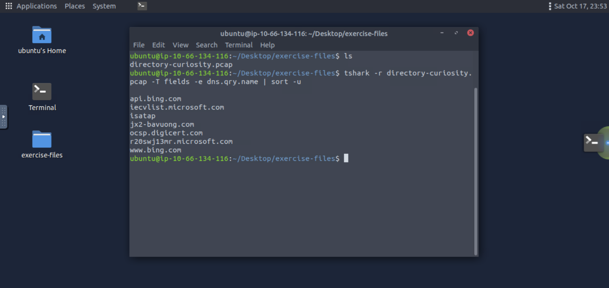

**Answer:** `jx2-bavuong[.]com`

### 2. What is the total number of HTTP requests sent to the malicious domain?

To count HTTP requests targeting this host, I filtered for the `http.host` field and counted the matching packets:

```bash
tshark -r directory-curiosity.pcap \
  -Y 'http.request && http.host == "jx2-bavuong.com"' \
  -T fields -e frame.number | wc -l
```

The capture contains **14** matching requests. The `http.request` condition makes the purpose of the filter explicit, while `wc -l` counts the returned frame numbers.

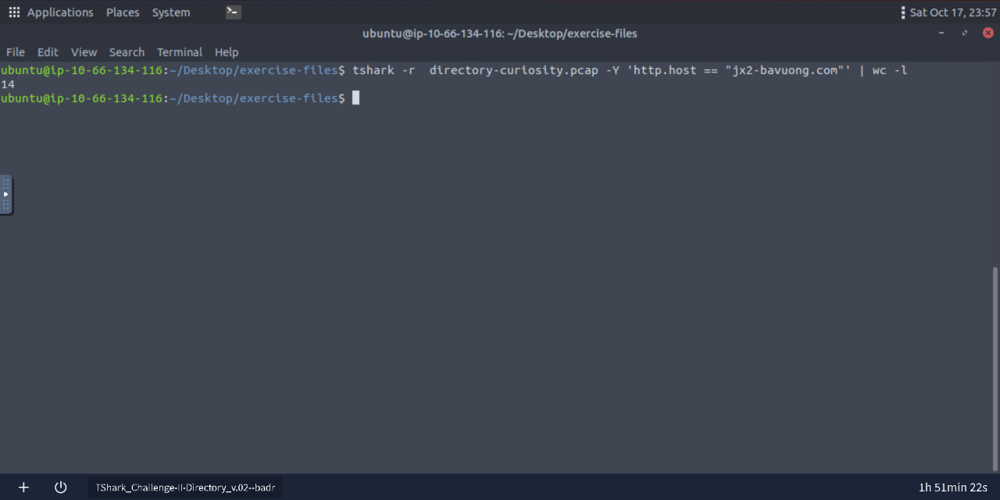

**Answer:** `14`

### 3. What is the IP address associated with the malicious domain?

I displayed the destination IP address alongside the HTTP Host header:

```bash
tshark -r directory-curiosity.pcap \
  -Y 'http.host == "jx2-bavuong.com"' \
  -T fields -e ip.dst -e http.host
```

The HTTP requests to `jx2-bavuong.com` were directed to `141.164.41.174` in the capture.

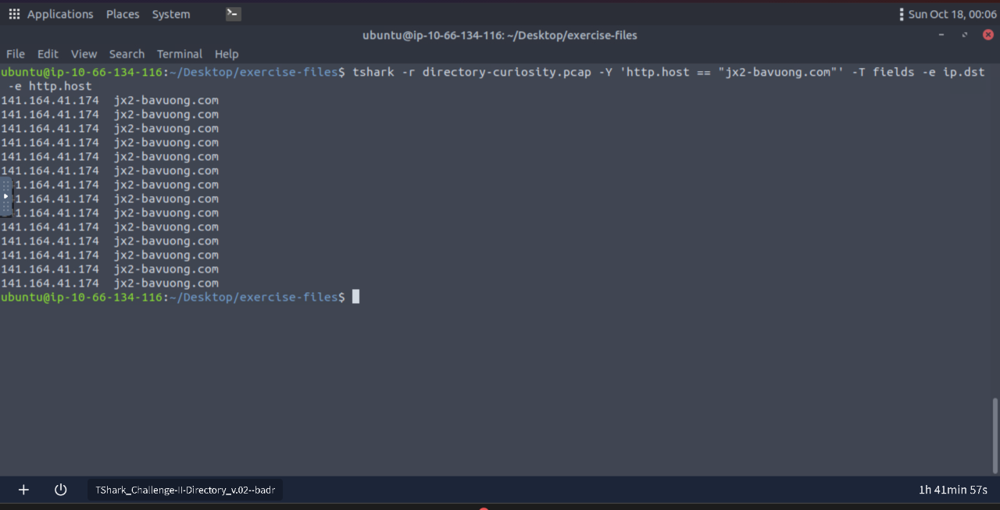

**Answer:** `141[.]164[.]41[.]174`

*Note: This establishes the IP used for the captured HTTP traffic; it is not a separate, historical DNS-resolution verification.*

### 4. What is the server information of the suspicious domain?

I examined verbose packet details for responses originating from the server IP and searched for the HTTP `Server` header:

```bash
tshark -r directory-curiosity.pcap \
  -Y 'ip.src == 141.164.41.174 && http.response' -V | grep 'Server:'
```

The response header identified the following server software:

```text
Apache/2.2.11 (Win32) DAV/2 mod_ssl/2.2.11 OpenSSL/0.9.8i PHP/5.2.9
```

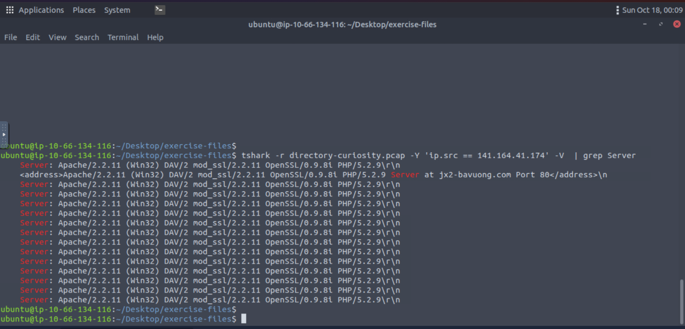

**Answer:** `Apache/2.2.11 (Win32) DAV/2 mod_ssl/2.2.11 OpenSSL/0.9.8i PHP/5.2.9`

### 5. What is the number of listed files?

To find relevant TCP streams, I displayed stream IDs and endpoints for traffic involving the suspicious IP:

```bash
tshark -r directory-curiosity.pcap \
  -Y 'ip.addr == 141.164.41.174' \
  -T fields -e tcp.stream -e ip.src -e ip.dst | sort -u
```

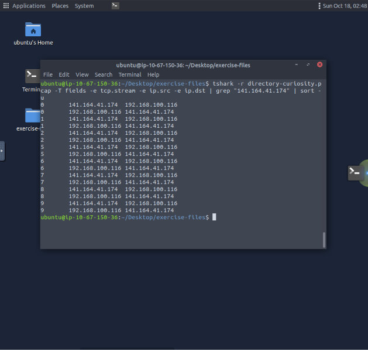

I then followed TCP stream **0**, which contained an HTML directory listing:

```bash
tshark -r directory-curiosity.pcap -z follow,tcp,ascii,0
```

The HTML response had the title `Index of /` and contained three file links:

- `123.php`
- `vlauto.exe`
- `vlauto.php`

This is an exposed directory index. The filenames appear as hyperlink targets in the HTML `href` attributes; they are not files embedded in image tags.

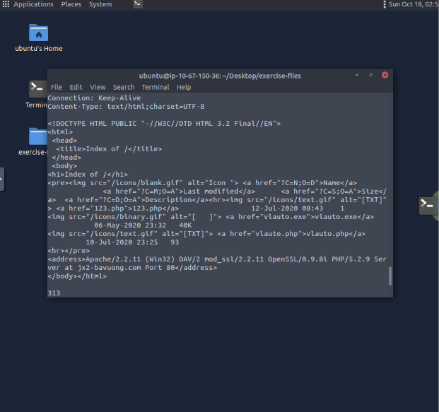

**Answer:** `3`

### 6. What is the filename of the first file?

Reading the file links in the recovered HTML directory listing, the first listed entry was `123.php`.

**Answer:** `123.php`

### 7. What is the name of the downloaded executable file?

Among the three listed entries, the Windows executable is `vlauto.exe`. I confirmed the file was present among the HTTP objects exported in the next step.

**Answer:** `vlauto.exe`

### 8. What is the SHA-256 value of the malicious file?

I exported the HTTP objects from the PCAP into a local folder:

```bash
mkdir -p extracted
tshark -r directory-curiosity.pcap --export-objects http,extracted
```

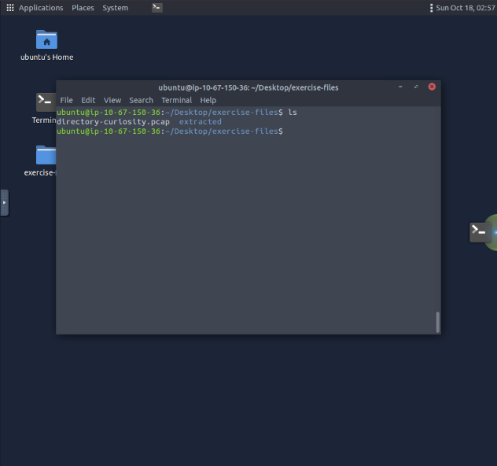

I changed into the extraction folder and verified that `vlauto.exe` was present:

```bash
cd extracted
ls
```

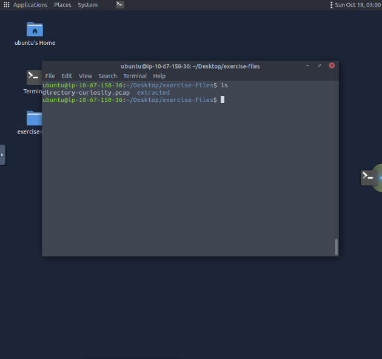

I then calculated the executable's SHA-256 checksum:

```bash
sha256sum vlauto.exe
```

The result was:

```text
b4851333efaf399889456f78eac0fd532e9d8791b23a86a19402c1164aed20de  vlauto.exe
```

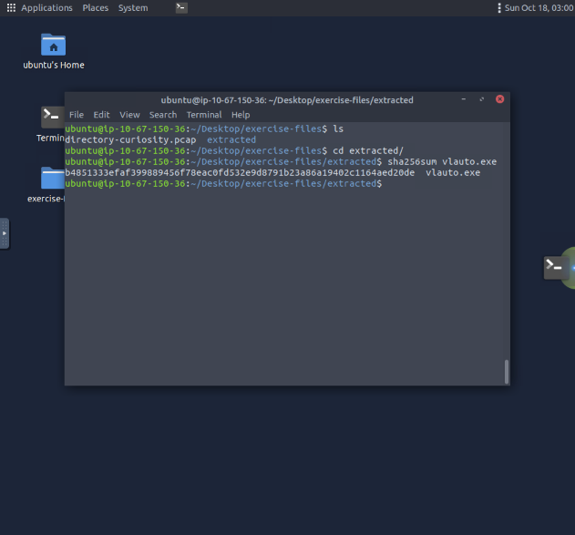

**Answer:** `b4851333efaf399889456f78eac0fd532e9d8791b23a86a19402c1164aed20de`

> **Safety note:** Treat extracted executables from suspicious traffic as potentially harmful. Calculate hashes and inspect them in a controlled environment; do not execute the sample on your everyday machine.

### 9. What is the "PEiD packer" value?

I searched the executable's SHA-256 hash on VirusTotal and opened the **Details** tab. Under the file properties, the **PEiD packer** field reported:

```text
.NET executable
```

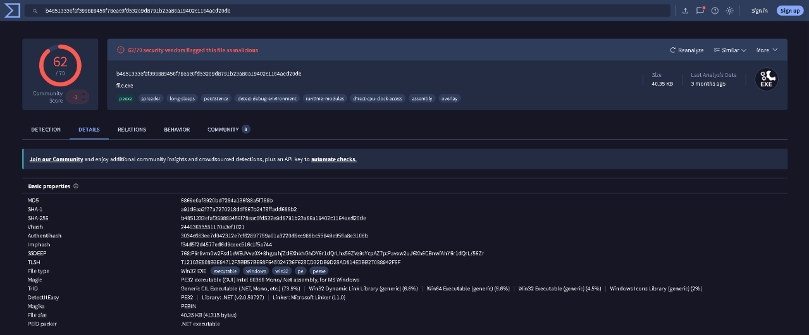

**Answer:** `.NET executable`

*This field describes the executable's identified format/signature; it is not, by itself, a malware verdict.*

### 10. What does the "Lastline Sandbox" flag this as?

I opened the **Behavior** tab on VirusTotal and checked **Dynamic Analysis Sandbox Detections**. The Lastline Sandbox verdict was:

```text
MALWARE TROJAN
```

Other sandbox verdicts shown in the screenshot also identified the file as malicious or suspicious.

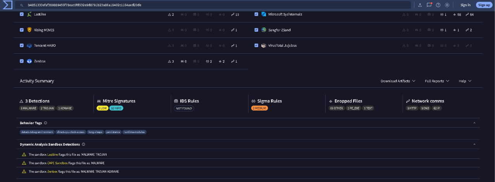

**Answer:** `MALWARE TROJAN`

## Indicators of Compromise (IOCs)

| Indicator | Value | Evidence |
| --- | --- | --- |
| Suspicious domain | `jx2-bavuong[.]com` | DNS queries and HTTP Host header |
| Server IP | `141[.]164[.]41[.]174` | HTTP destination IP |
| Downloaded file | `vlauto.exe` | HTTP object extraction |
| SHA-256 | `b4851333efaf399889456f78eac0fd532e9d8791b23a86a19402c1164aed20de` | `sha256sum` and VirusTotal lookup |
| Executable classification | `.NET executable` | VirusTotal PEiD packer field |
| Sandbox detection | `MALWARE TROJAN` | VirusTotal / Lastline Sandbox |

*Domains and IP addresses are defanged in narrative and IOC fields to reduce accidental clicks. The TShark commands use their original values so the filters remain reproducible.*

## Conclusion

The packet capture shows HTTP communication with `jx2-bavuong.com`, an accessible directory index containing an executable link, and an HTTP object from which `vlauto.exe` was recovered. The file's hash led to a VirusTotal report with strong malicious-file detections, including a **Lastline Sandbox: MALWARE TROJAN** result.

Together, these observations support the alert as a **true positive for contact with, and retrieval of, a malicious file**. The capture evidence described here does **not**, on its own, establish that the executable ran successfully on the endpoint or that persistence was achieved.

## Lessons Learned

1. **Pivot from DNS to HTTP.** DNS queries are useful starting points, but additional traffic and artifacts are needed to assess risk.
2. **Use TShark display filters to narrow the investigation.** The `http.host`, `ip.addr`, and `tcp.stream` fields help connect domain activity to server responses and transferred files.
3. **Follow TCP streams to recover context.** Stream reconstruction revealed the exposed directory listing and its file links.
4. **Extract and hash artifacts without executing them.** `--export-objects` and `sha256sum` enabled file identification and reputation checks while avoiding direct execution.
5. **Corroborate the alert with multiple kinds of evidence.** Network data, recovered content, and sandbox results provided a stronger case than an unusual domain name or one security detection alone.
