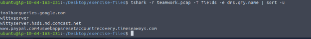
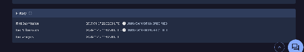
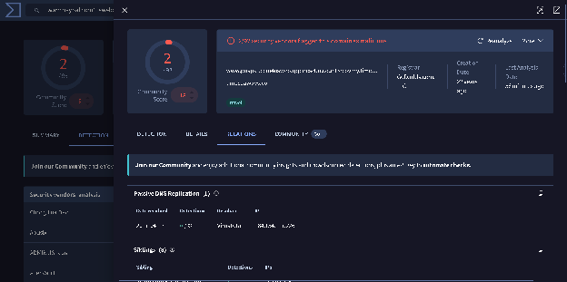
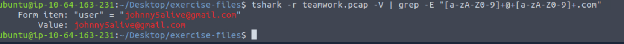

# TShark Challenge I: Teamwork

**Platform:** TryHackMe  
**Difficulty:** Easy  
**Topic:** Network Security, Network Traffic Analysis, Threat Intelligence  
**Tools:** TShark, VirusTotal, Linux Command Line

## Summary

In this room, I investigated a packet capture (`teamwork.pcap`) to identify a suspicious domain and collect related indicators of compromise (IOCs). I used TShark to extract DNS queries and inspect packet details, then used VirusTotal to research the domain's submission history and associated IP address. The investigation also revealed an email address in the captured traffic.

## Scenario

> An alert has been triggered: “The threat research team discovered a suspicious domain that could be a potential threat to the organisation.”

The goal was to examine the network capture, identify the suspicious domain, and gather information that could help an analyst understand the potential threat.

## Investigation and Solutions

### 1. What is the full URL of the malicious/suspicious domain address?

I started by navigating to the directory containing `teamwork.pcap` and reviewing the DNS queries. Because DNS is used to resolve domain names, it was a useful starting point for identifying unusual destinations.

```bash
cd ~/Desktop/exercise-files
tshark -r teamwork.pcap -T fields -e dns.qry.name | sort -u
```

The command:
- Reads the saved packet capture with `-r`.
- Extracts the `dns.qry.name` field with `-T fields -e dns.qry.name`.
- Uses `sort -u` to display unique domain names.

One entry stood out because it used PayPal-related wording in a misleading hostname:

```text
www.paypal.com4uswebappsresetaccountrecovery.timeseaways.com
```



**Answer:** `www.paypal.com4uswebappsresetaccountrecovery.timeseaways.com`

**Technical note:** The command identifies a fully qualified domain name (FQDN), not a complete URL. A complete URL would also include a scheme (such as `https://`) and could include a path. The room asks for a URL, but this is the hostname established by the DNS evidence.

### 2. When was the suspicious URL first submitted to VirusTotal?

Next, I searched for the suspicious indicator on [VirusTotal](https://www.virustotal.com/), which provides reputation information and historical analysis for URLs, domains, IP addresses, and files.

In the relevant VirusTotal report, I checked the **History** section for the **First Submission** timestamp.



**Answer:** `2017-04-17 22:52:53 UTC`

This timestamp describes the first submission recorded for the analyzed indicator. It does **not** necessarily represent when the domain was registered, when it first became malicious, or when the activity in the packet capture occurred.

### 3. Which known service was the domain trying to impersonate?

The hostname contains `paypal` and account-recovery wording intended to resemble a legitimate PayPal-related address. However, the actual registered domain at the end of the hostname is `timeseaways.com`, **not** `paypal.com`.

This is a common form of deceptive domain naming: attackers place a trusted brand's name earlier in a hostname to make the address appear legitimate at a glance.

**Answer:** **PayPal**

### 4. What is the IP address associated with the suspicious domain?

I used the VirusTotal report to investigate the network infrastructure associated with the suspicious domain. The report identified the following IP address:



**Answer:** `184.154.127.226`

VirusTotal can provide historical DNS resolution information, so an associated IP address should not automatically be treated as the domain's current IP address. During a real investigation, I would compare the report's timestamps with the packet capture and look for corresponding DNS response records.

### 5. What email address was used?

To find email addresses in the packet capture, I reviewed the verbose packet details and filtered the output with `grep`:

```bash
tshark -r teamwork.pcap -V | grep -Eio '[a-zA-Z0-9]+@+[a-zA-Z]+.com' | sort -u
```

The command uses `-V` to display detailed packet information and a regular expression to extract strings resembling email addresses. 

The captured packet details included an email address in a form field:



**Answer:** `johnny5alive@gmail.com`

In a real investigation, I would also inspect the surrounding packet and conversation to determine the context of the form submission instead of assuming that the email address belongs to the attacker.

## Lessons Learned

- **DNS is a useful starting point for network investigations.** Extracting unique queried hostnames can quickly reveal unusual destinations in a PCAP, but DNS queries alone do not prove that a connection succeeded.
- **The registered domain matters more than familiar branding in a hostname.** A hostname containing `paypal` is not necessarily controlled by PayPal. Reading the domain from right to left helps reveal deceptive naming.
- **Threat intelligence adds context to packet evidence.** VirusTotal can connect an indicator to historical submissions and infrastructure, but its records need to be interpreted alongside capture timestamps.
- **TShark is useful for repeatable, command-line packet analysis.** Field extraction, verbose packet inspection, and Linux text-processing tools make it possible to identify IOCs without relying entirely on a graphical interface.
- **Evidence needs careful interpretation.** Finding an email address or IP in traffic is an investigative lead, not proof of who conducted the attack. Correlation with related packets and additional evidence is essential.


